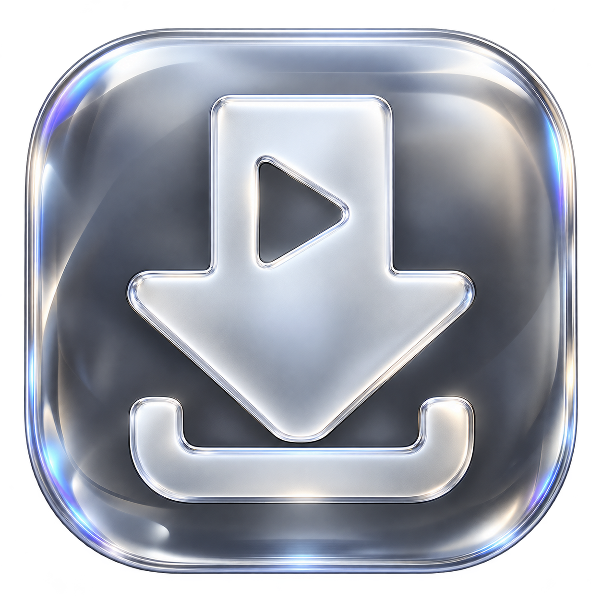

<p align="center">
  
</p>

# Video Studio

**Bağlantıdan, arşivine.** Türkçe arayüzüyle Windows üzerinde video ve ses indirmeyi tek bir çalışma alanında toplayan masaüstü uygulaması.


[İndir](https://github.com/ICARUS2323/Video-Studio/releases/latest) · [Kullanım rehberi](KULLANIM.md) · [Ekran görüntüleri](docs/SCREENSHOTS.md) · [Doğrulama](docs/VALIDATION.md) · [Sorun bildir](https://github.com/ICARUS2323/Video-Studio/issues)


## Neden geliştirildi?

Video Studio, video bağlantısını analiz etme, uygun kaliteyi seçme, video veya ses olarak kaydetme ve indirilen dosyalara yeniden ulaşma adımlarını Türkçe bir Windows arayüzünde birleştirmek amacıyla geliştirildi. yt-dlp ve FFmpeg gibi komut satırı araçlarının yeteneklerini, terminal komutları yazmadan kullanılabilir hale getirir.

Proje; WPF ile masaüstü arayüzü geliştirme, harici süreçleri asenkron yönetme, indirme ilerlemesini işleme, kalıcı ayar saklama ve gerçek medya dosyalarıyla entegrasyon testi konularını bir araya getirir.

## Özellikler

| Alan | Yapabildikleri |
| --- | --- |
| Bağlantı analizi | Başlık, kanal, süre, küçük resim ve kullanılabilir formatları gösterir. |
| MP4 video | Kaynakta sunulan çözünürlükleri listeler; varsa 4K, 1440p, 1080p ve daha düşük kaliteler seçilebilir. Video ve ses gerektiğinde birleştirilir. |
| MP3 ses | 128, 192, 256 veya 320 kbps seçimi sunar. Kaynakta ses yoksa ses indirme kapatılır. |
| İndirme takibi | Gerçek ilerleme, hız, kalan süre, kayıt konumu seçimi ve alt süreçleri de durduran iptal işlemi. |
| İndirilenler | Geçmişten dosya ve klasör açma; silinmiş dosyaları yenileme sırasında listeden kaldırma. |
| Görünüm | Liquid Glass Gri, Gece Camı, Aurora ve Porselen olmak üzere dört tema. |
| Kalıcı tercihler | Tema, ses kalitesi, kayıt konumu ve geçmiş; atomik kayıt ve yedekten kurtarma. |
| Erişim ve motor | Kullanıcının seçtiği cookies.txt desteği, açıklayıcı erişim hataları ve SHA256 doğrulamalı yt-dlp güncellemesi. |

YouTube, Instagram, X, TikTok ve yt-dlp tarafından desteklenen diğer platformlarla çalışacak şekilde tasarlanmıştır. Erişim koşulları ve platform değişiklikleri sonuçları etkileyebilir. Instagram, X ve TikTok için bu yayına hazırlık sırasında canlı indirme testi yapılmadı.

## İndir ve çalıştır

1. [Son sürümden](https://github.com/ICARUS2323/Video-Studio/releases/latest) **VideoStudio-win-x64.zip** dosyasını indirin.
2. ZIP'i bir klasöre tamamen çıkartın.
3. Bilgisayarınızda **.NET 10 Desktop Runtime (x64)** kurulu olduğundan emin olun.
4. Çıkartılan `VideoStudio` klasöründeki **VideoStudio.exe** dosyasını açın.

Yalnızca EXE'yi taşımayın; `tools` klasörü ve diğer dosyalar da gereklidir. Hazır paket yt-dlp, FFmpeg/ffprobe ve Deno içerir. Kaynak kod ZIP'i bu motorları ve çalıştırılabilir uygulamayı içermez; kaynak koddan çalıştırmak için aşağıdaki derleme adımlarını kullanın.

## Nasıl kullanılır?

1. **Yeni indirme** ekranına video bağlantısını yapıştırın; gerekirse **Bağlantıyı incele** düğmesine basın.
2. **MP4 video** veya **MP3 ses** seçin.
3. Sunulan çözünürlüğü ya da ses bit hızını ve kayıt klasörünü belirleyin.
4. İndirmeyi başlatın; tamamlanan dosyaya **İndirilenler** ekranından ulaşın.

Ayrıntılı adımlar için [KULLANIM.md](KULLANIM.md), YouTube erişim sorunları için [YOUTUBE-YARDIM.md](YOUTUBE-YARDIM.md).

## Ekran görüntüleri

Görüntüler uygulamanın gerçek WPF arayüzünden, örnek medya bilgisiyle önizleme modunda üretildi. Gösterilen 4K seçeneği örnek veriye aittir; her videoda 4K bulunacağı anlamına gelmez.

| Gece Camı | Aurora |
| --- | --- |
|  |  |

Porselen teması ve görünüm sayfası dahil tüm görüntüler: [ekran görüntüsü galerisi](docs/SCREENSHOTS.md).

## Kaynak koddan derleme

Gereksinimler: **Windows x64**, **.NET 10 SDK**, **Node.js** ve **Git**. Uygulamanın harici NuGet paket bağımlılığı yoktur.

```powershell
git clone https://github.com/ICARUS2323/Video-Studio.git
cd Video-Studio
powershell.exe -NoProfile -ExecutionPolicy Bypass -File tools/build.ps1 -PrepareTools
powershell.exe -NoProfile -ExecutionPolicy Bypass -File tools/package.ps1
```

İlk betik resmi GitHub sürümlerinden motorları indirir, yayımlanan SHA256 değerlerini doğrular ve uygulamayı derler. `ExecutionPolicy Bypass` yalnızca başlatılan PowerShell işlemi için geçerlidir. Motorlar hazır olduğunda sonraki derlemelerde `-PrepareTools` kaldırılabilir.

- Uygulama: `release/VideoStudio/VideoStudio.exe`
- Dağıtım paketi: `release/VideoStudio-win-x64.zip`
- İsteğe bağlı simge üretimi: `tools/build-icon.ps1`

## Proje yapısı

```text
src/                   WPF arayüzü, indirme motoru, veri modelleri ve doğrulamalar
src/Assets/            Uygulama simgesi ve logo üretim notları
tools/                 Motor hazırlama, derleme ve paketleme betikleri
docs/                  Ekran görüntüleri ve doğrulama özeti
KULLANIM.md            Son kullanıcı rehberi
YOUTUBE-YARDIM.md       YouTube erişim sorunlarına ilişkin açıklamalar
THIRD-PARTY.md         Harici bileşenler ve lisans bağlantıları
```

`vendor/`, `release/`, `artifacts/` ve yerel kullanıcı verileri Git deposuna alınmaz. Paketleme işlemi uygulamanın `data/` klasörünü ZIP dışında tutar.

## Doğrulama

Derlemeden sonra PowerShell'de:

```powershell
$app = Resolve-Path ./release/VideoStudio/VideoStudio.exe
Start-Process $app -ArgumentList '--self-test','artifacts/self-test' -Wait
Start-Process $app -ArgumentList '--history-test','artifacts/history-test' -Wait
Start-Process $app -ArgumentList '--access-test','artifacts/access-test' -Wait
Start-Process $app -ArgumentList '--lifecycle-test','artifacts/lifecycle-test' -Wait
Start-Process $app -ArgumentList '--integration-test','artifacts/integration-test' -Wait
Start-Process $app -ArgumentList '--preview','artifacts/preview' -Wait
```

Her komut kendi çıktı klasörüne `result.txt` yazar. Entegrasyon testi yerel HTTP sunucusunda gerçek HLS üretir, MP4 ve MP3 indirir, ffprobe ile akışları doğrular ve iptal davranışını kontrol eder. İsteğe bağlı `--network-test` ve `--online-test <çıktı-klasörü> <bağlantı>` internete erişir; çevrimiçi test gerçek dosya indirir. Yayın öncesi çalıştırılan kontroller: [doğrulama özeti](docs/VALIDATION.md).

## Kapsam ve harici bileşenler

Canlı yayın, DRM korumalı içerik ve toplu çalma listesi indirme desteklenmez. YouTube'un 429 veya insan doğrulaması yanıtları için uygulama açıklama sunar; platformun erişim kısıtlamalarını kaldıramaz. Yüksek MP3 bit hızı, kaynak sesin kalitesini artırmaz.

Oturum dosyası yalnızca kullanıcı seçtiğinde kullanılır; tarayıcı oturumları kendiliğinden okunmaz. İçerikleri kullanım hakkınız ve ilgili platformun koşulları çerçevesinde indirin.

Harici araçların lisansları ve kaynak bağlantıları [THIRD-PARTY.md](THIRD-PARTY.md) dosyasında, paket içindeki lisans metinleri `VideoStudio/tools/licenses/` klasöründedir.
