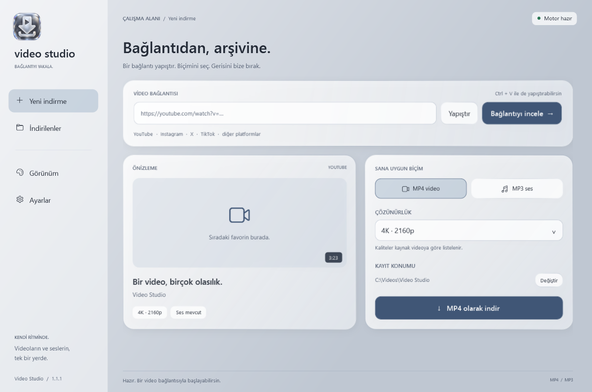
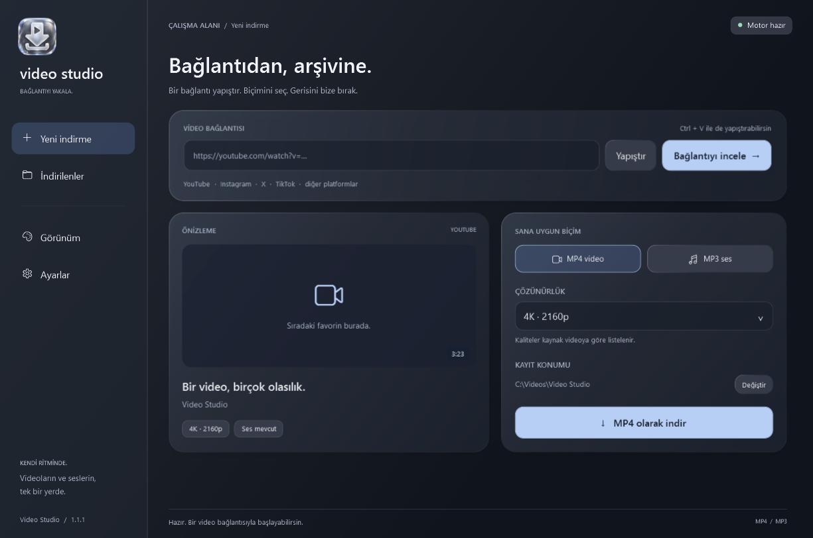
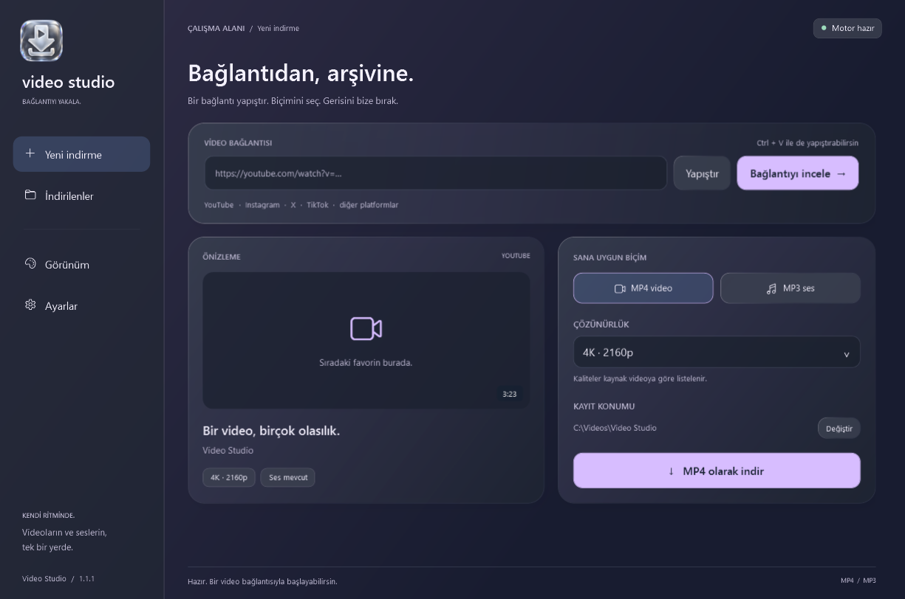
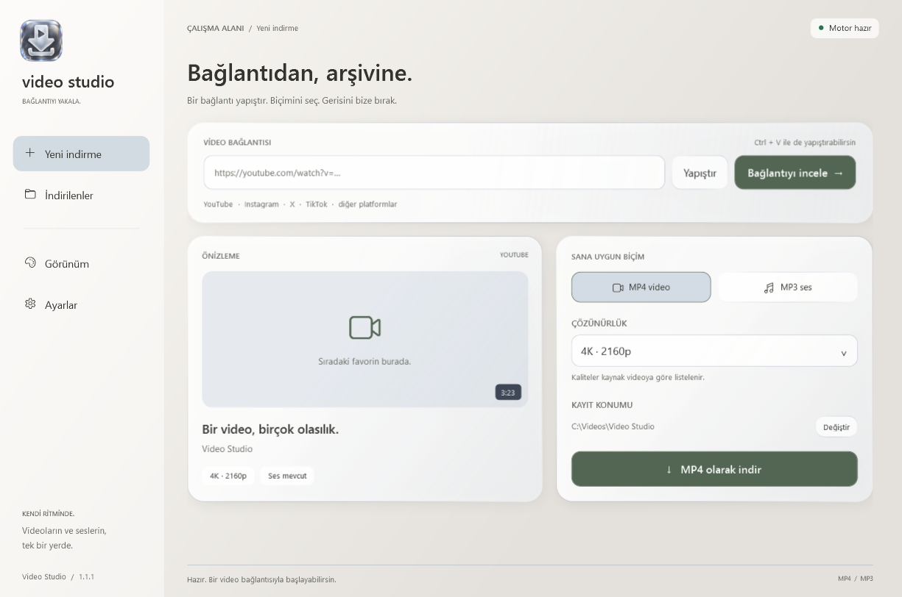
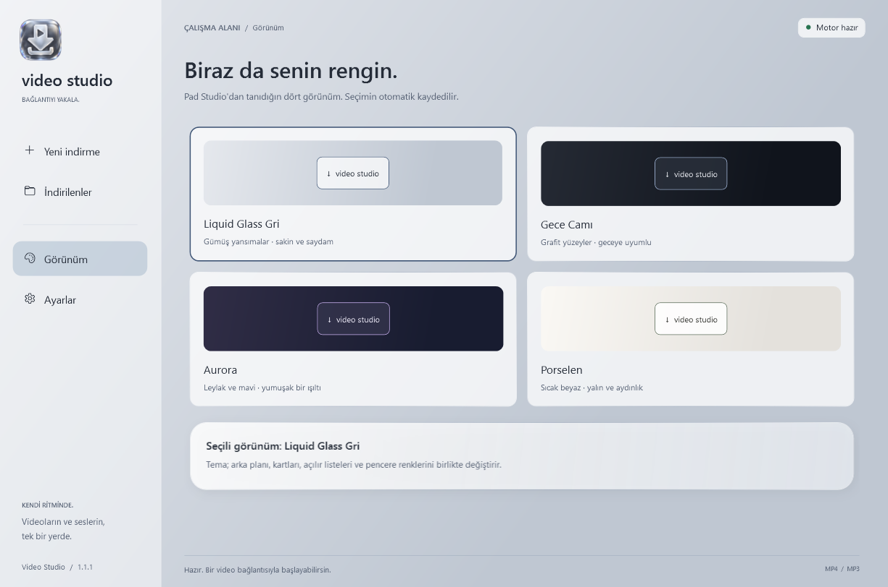

# Ekran görüntüleri

Video Studio 1.1.1'in gerçek WPF arayüzünden `--preview` komutuyla üretilmiştir. Medya başlığı, süre ve çözünürlükler örnek veridir; kayıt konumu gösterim amacıyla `C:\Videos\Video Studio` olarak ayarlanmıştır. Kişisel geçmiş veya oturum bilgisi içermez.

## Liquid Glass Gri

## Gece Camı

## Aurora

## Porselen

## Görünüm seçimi

[Proje sayfasına dön](../README.md)
